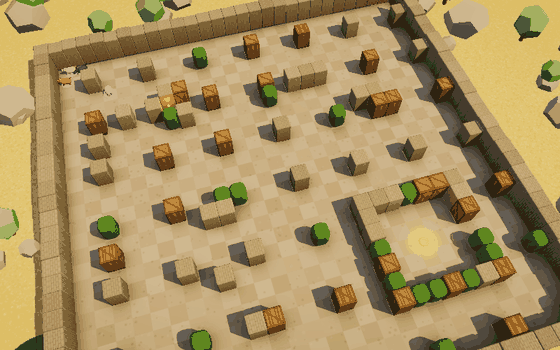
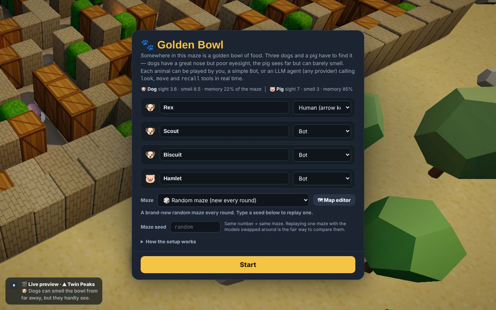
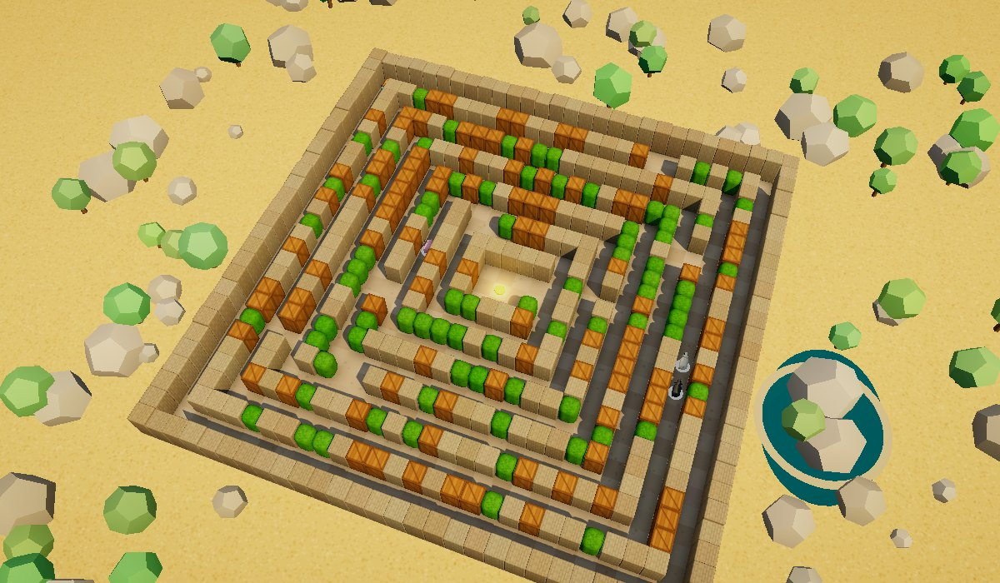
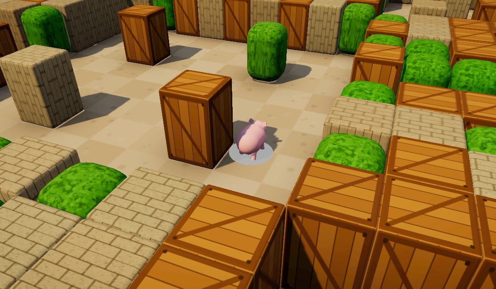
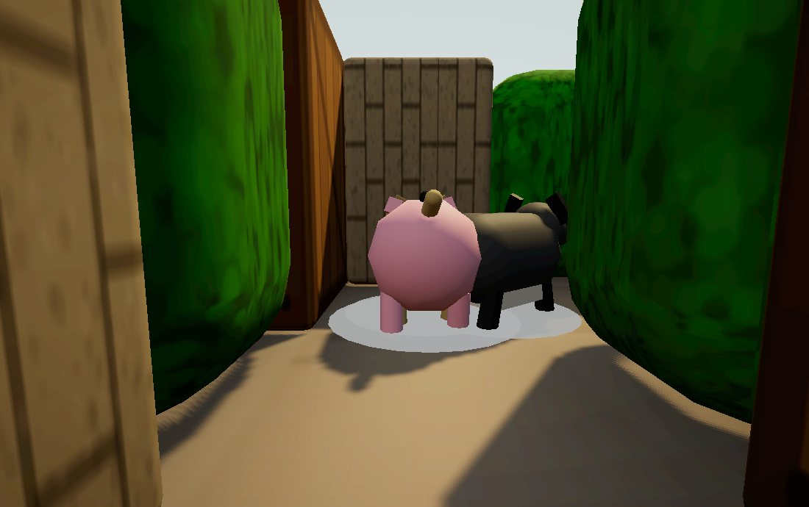
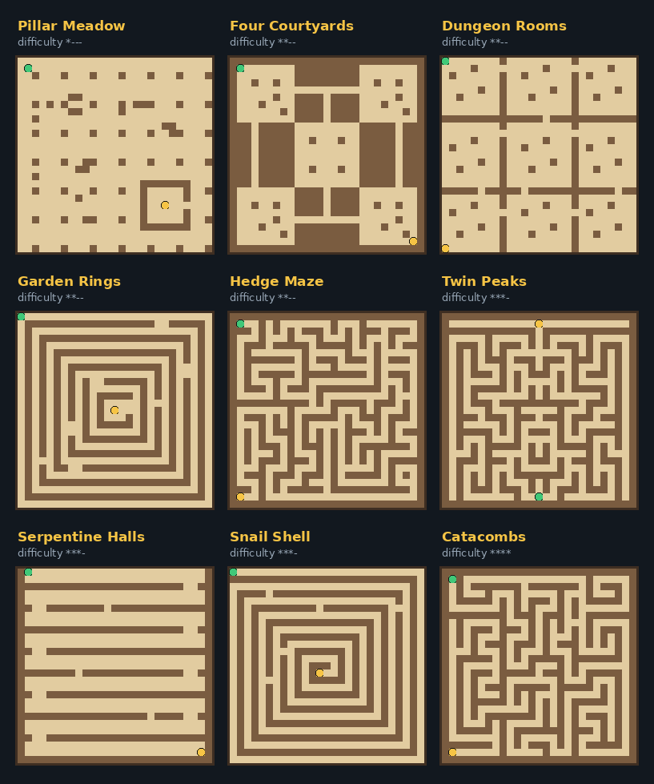
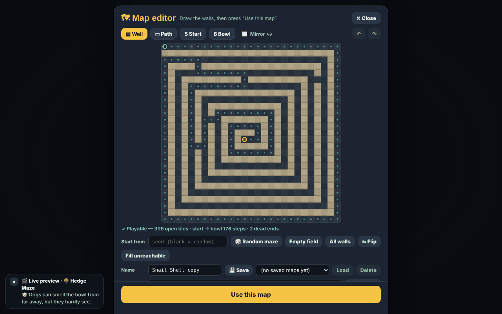
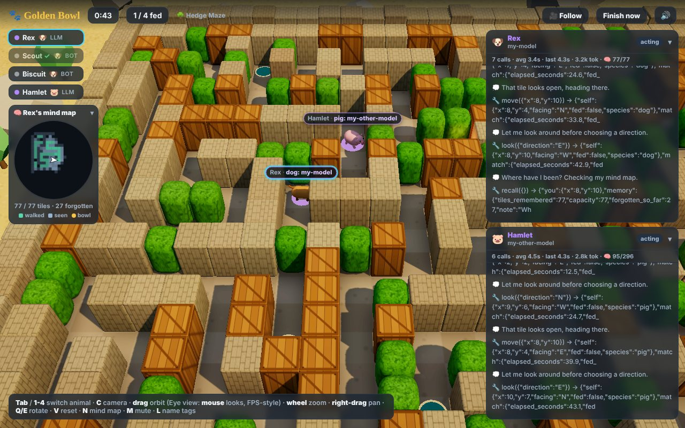

<div align="center">

# 🐾 Golden Bowl

**Three dogs and a pig search a maze for a golden bowl of food.**
Play it yourself, watch simple bots race, or give each animal its own **LLM brain** and see which model finds the bowl first.

[**▶ Play it in your browser**](https://gold.starverse.chat/) &nbsp;·&nbsp; no install, no account, one HTML file



</div>

> Replace `YOUR-USERNAME` / `golden-bowl` in the link above with your own GitHub Pages address.

---

## What is this?

Golden Bowl is a real-time 3D maze game that runs entirely in your browser. A golden bowl is hidden somewhere in the maze, and four animals set off to find it:

- 🐶 **Dogs** have a great nose but poor eyesight. They can smell the bowl through walls from far away, but they only see a short way.
- 🐷 **The pig** sees far down the corridors but can barely smell, and it remembers far more of the maze than a dog does.

Each animal can be controlled by:

| Control | What it is |
|---|---|
| 🎮 **Human** | You, with the arrow keys / WASD |
| 🤖 **Bot** | A built-in explorer that follows its nose, remembers where it has been, and avoids going in circles |
| 🧠 **LLM agent** | A language model of your choice (Claude, GPT, DeepSeek, a local Ollama model, …) that plays by calling tools |

You can mix them freely, for example *you* against a bot, or Claude against GPT against DeepSeek. The world runs in real time (60 FPS) and **never waits for a model to answer**, so slow models really are at a disadvantage.



## Quick start

1. Open the game (link above, or open `index.html` from this repo in Chrome).
2. For each animal pick **Human**, **Bot** or **LLM Agent**.
3. Pick a map, or leave it on 🎲 *Random maze*.
4. Press **Start**.

You only need an API key if you choose *LLM Agent* for an animal.

## Watching and playing



| Key / mouse | Action |
|---|---|
| **Arrow keys / WASD** | Move your animal (relative to the screen) |
| **Tab / 1–4** | Switch which animal the camera and mind map follow |
| **C** | Cycle the camera: Overview → Follow → Eye (first person) |
| **Mouse drag** | Orbit the camera (Overview / Follow) |
| **Mouse wheel** | Zoom (in Eye view: field of view) |
| **Right-drag** | Pan (Overview) |
| **Q / E** | Rotate the camera |
| **V** | Reset the camera |
| **N** | Show / hide the mind map |
| **M** | Mute |
| **L** | Show / hide name tags |

In **Eye view** the mouse works like an FPS: click to capture it, move to look around, **Esc** to release it.

| Follow camera | Eye (first-person) view |
|---|---|
|  |  |

## The animals' abilities

| | 🐶 Dog | 🐷 Pig |
|---|---|---|
| Sight | short (3.6 tiles), narrow cone | long (7 tiles), wide cone |
| Smell | strong (8.5 tiles), works through walls | weak (3 tiles) |
| Memory ("mind map") | about **22 %** of the maze | about **85 %** of the maze |
| LLM conversation history | last **4** actions | last **10** actions |
| Speed | 3.1 tiles/s | 2.6 tiles/s |

Memory is real: every animal keeps a bounded *mind map* of the tiles it walked on or saw. When the map is full, old memories fade into "unknown". Press **N** to watch the focused animal's mind map (green = walked, blue = seen, gold = the bowl).

## Maps

Nine hand-designed maps ship with the game, plus an endless supply of random mazes. Pick **🎰 All built-in maps, one after another** to get a different map every round.



*Green = start, gold = the bowl.* Easy open fields favour the pig; long twisting corridors favour the nose of a dog.

### Map editor

Draw your own maze, check that the bowl is reachable, save it in your browser, and **share it as a short text code** (`GB1-…`) that a friend can paste into their game.



## Playing with LLM agents

Choose **LLM Agent** for any animal and fill in its connection card:

| Field | Meaning |
|---|---|
| **Protocol** | Anthropic Messages, OpenAI Chat Completions (also used by most compatible servers), or OpenAI Responses |
| **Base URL** | e.g. `https://api.anthropic.com`, `https://api.openai.com/v1`, `https://api.deepseek.com`, `http://localhost:11434/v1` |
| **Model** | The model name your provider expects |
| **Thinking** | Optional reasoning level (`low`, `medium`, `high`, …). Leave on *default* to send nothing |
| **API key** | Typed in the page, kept in memory only |

There are one-click **presets** (Anthropic, OpenAI, DeepSeek, OpenRouter, local Ollama), and every animal has its **own** card, so different animals can run different models or providers. Each LLM animal gets a live **info panel** with its tool calls, replies, response times and token counts.



### What does the model actually see?

**Not the picture.** The model never receives the rendered first-person view or any screenshot. Everything is **text**, and deliberately limited to what that animal could sense:

1. **A system prompt** with the rules: the goal, the coordinate system (`N` increases *y*, `E` increases *x*), how smell and memory work, and the animal's own memory capacity.
2. **Three tools** it can call:
   - `look(direction)` – turn to one of 8 compass directions and report what is in front of you.
   - `move(x, y)` – walk toward a tile (takes real seconds; can be interrupted at any time).
   - `recall()` – read your own **mind map** as an ASCII drawing.
3. **A status object** after every action. It contains the animal's own tile and facing, match info (elapsed seconds, how many animals are fed), the *names/species/fed state* of the others (but **not where they are**), how full its memory is, and a **smell reading** – distance, strength and compass bearing to the bowl – when the bowl is close enough to smell.
4. **After `look`**, a list of the tiles inside its sight cone, relative to itself (`dx`, `dy`) and typed `open`, `wall`, `bowl`, `dog` or `pig`. A dog's cone is short and narrow, a pig's long and wide.

A real status after a `look` (shortened):

```json
{
  "self":   { "x": 26, "y": 20, "facing": "N", "fed": false, "species": "dog" },
  "match":  { "elapsed_seconds": 25.2, "fed_count": 0, "total_animals": 4, "grid_size": 29 },
  "others": [ { "name": "Scout", "species": "dog", "fed": false }, { "name": "Hamlet", "species": "pig", "fed": false } ],
  "memory": { "tiles_remembered": 77, "capacity": 77 },
  "smell":  null,
  "visible": [ { "dx": 0, "dy": 0, "type": "open" }, { "dx": 0, "dy": 1, "type": "open" } ]
}
```

And what `recall()` returns, an ASCII mind map (`@` you, `B` bowl, `o` walked, `.` seen, `#` wall, `?` unknown or forgotten):

```text
    x: 1234567890123456789012345678
y=22 ??????????????????????????#?
y=21 ???????????????????????##.##
y=20 ????????????????????????.@.#
y=19 ??????????????????????#..o.#
y=18 ??????????????????????#ooo.#
y=17 ??????????????????????#o..##
```

There is no global map and no coordinates of the bowl until the animal has smelled or seen it. A dog's conversation history is trimmed to its last 4 actions and a pig's to 10, so the model has to use `recall()` to remember where it has been, which is exactly the "memory" ability of the species.

### Privacy: where do the API calls go?

The page is a **static file**. GitHub Pages (or any static host) only sends it to your browser once. After that:

```
static host ──(HTML, once)──► your browser ──► your LLM provider
                              (game runs here)   (api.openai.com, api.anthropic.com, …)
```

- The game runs **entirely in your browser** and sends every LLM request **straight from your computer to the provider you configured**.
- Your **API key is never sent to the host** of the page and is **not saved to disk**. The game remembers only protocol, URL, model and thinking level (in your browser's local storage).
- Each person who plays uses **their own key** from their **own browser**.

#### CORS and the optional local relay

Browsers only allow a web page to call an API if the API replies with CORS headers. Anthropic, OpenAI and DeepSeek all worked directly from the page in our tests, but providers and self-hosted servers differ and can change. If a connection fails with a network/CORS error, run the included tiny local relay:

```bash
python3 cors-proxy.py          # listens on http://localhost:8787
```

and put the provider's address after the relay's, e.g. `http://localhost:8787/https://api.example.com`, as the Base URL (there is a *DeepSeek via local relay* preset as an example). The relay binds to `127.0.0.1` only, forwards only to an allow-list of hosts (add more with `--allow HOST`), never logs keys or bodies, and needs only the Python 3 standard library. For a local Ollama server, allow the page's origin with the `OLLAMA_ORIGINS` environment variable.

## Run it locally

There is nothing to build. Open `index.html` in a modern browser (Chrome recommended), or serve the folder:

```bash
python3 -m http.server 8000
# then open http://localhost:8000
```

## Repository layout

```
index.html        the whole game (three.js is bundled inline) – this is all you need to host
cors-proxy.py     optional local relay for providers without CORS
docs/images/      screenshots and the animated preview used in this README
README.md         you are here
```

## Under the hood

- Single-file HTML, rendered with **three.js** (bundled inline) and a post-processing pass (bloom + colour grade); sounds are synthesised with the Web Audio API.
- The maze is a 29 × 29 tile grid. Random mazes come from a seeded recursive-backtracker (so the same seed always gives the same maze); built-in and custom maps are plain tile layouts.
- Animals sense with ray casts (sight) and distance (smell); bots explore with a frontier search over their own bounded mind map; LLM agents act through the same sensing and memory.
- LLM history is stored in a protocol-neutral format and converted per request to the Anthropic, OpenAI Chat or OpenAI Responses wire format, with automatic fallbacks for providers that reject the thinking setting.
- The setup screen runs the real engine with four bots as a live preview, rendered at reduced resolution and switched off automatically on slow machines.

## Credits and license

Built with [three.js](https://threejs.org/) (MIT licensed). Game code, maps and artwork: see the repository owner.

*Add a `LICENSE` file of your choice (for example MIT) before inviting contributions.*
